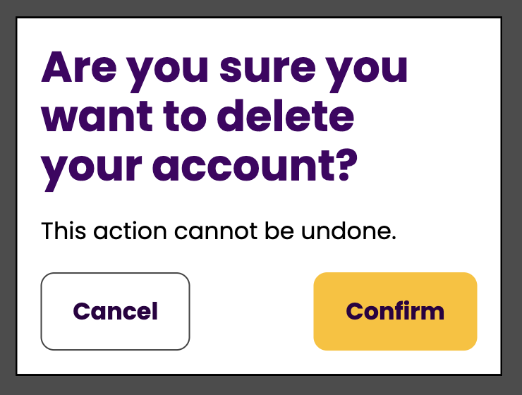

# Dialog

## Overview

A dialog component appears over the top of the main content to present information or request user input. It can be modal or non-modal:

- **Modal** dialogs demand immediate attention by blocking interaction with the rest of the page. When a modal dialog is open, all content behind it becomes inert, the page cannot be scrolled, and keyboard focus is contained within it.

- **Non-modal** dialogs allow people to still interact with the page content behind them.

It should always be easy and obvious how to dismiss a dialog. As well as using clear controls, we recommend adding an event listener to close the dialog using the <kbd>Escape</kbd> key.

[View the dialog component on TetraLogical.com](https://tetralogical.com/resources/accessible-components-library/dialog/)

### What problems it solves

* Modal dialogs help focus people's attention on a specific task or decision, minimising distractions and reducing the risk of unintended actions, such as accidental deletions or submissions
* Non-modal dialogs allow focused attention while still being able to see or interact with the rest of the page content as needed

### When to use it

* **Modal dialog**: When you need to interrupt the user flow to ask for input or confirmation, or to deliver important information that requires people's attention before they continue, for example confirming a delete action
* **Non-modal dialog**: For supplementary content, secondary features, or when people still need to be able to access background content, for example a web chat

### When not to use it

Do not use dialogs for:

- Messages that will unnecessarily disrupt people, or obscure important context
- Frequent, low-priority notifications
- Multi-step processes

### Where to use it

Modal dialogs visually open in the centre of the viewport, on top of everything else.

Place a modal dialog in the HTML as a direct child of the `<body>` element, as a modal dialog has to make the rest of the page inert, and it can only do that cleanly when nothing else is wrapped around it. Nested inside another element, it remains part of that element's landmark in the accessibility tree, and could become hidden or inert by inheriting from its ancestors. Any fallback script that makes the dialog's siblings inert would also leave the rest of the page interactive.

Non-modal dialogs visually sit in the bottom right corner of the viewport, where they are least likely to cover the content people are working with. However, if a non-modal dialog obscures the element that has keyboard focus, it temporarily moves out of the way.

Place a non-modal dialog in the HTML wherever it is most logical, ideally close to the control that opens it. Because the browser renders an open dialog on top of other elements, it's easy for it to feel detached, so its position in the markup is important to provide context for screen reader users.

### How it works

The component is built using a native `<dialog>` element. Each control points at its dialog with the `commandfor` attribute and says what it does with the `command` attribute: `show-modal` opens a modal dialog, `--show` opens a non-modal one, and `close` closes either. A modal dialog makes the rest of the page inert and dims it, and also carries `aria-modal="true"`. A non-modal dialog leaves the page interactive.

When a dialog opens, focus moves to the dialog itself, so that its name and content are announced together. When it closes, focus returns to the control that opened it, regardless of how it was dismissed. The <kbd>Escape</kbd> key also closes either dialog.

Inside a modal dialog, <kbd>Tab</kbd> wraps from the last control back to the first. The browser would otherwise let focus leave the dialog and enter the browser toolbar, which can be confusing while the page behind is inert.

A non-modal dialog sits over the page, but the page is still active. This means it can hide the focus indicator on elements behind it. When that happens the dialog temporarily moves out of the way, and moves back once focus has moved on.

### Without JavaScript

The modal variant works without the script in browsers that support invoker commands, which are Chrome and Edge 135, Firefox 144 and Safari 26.2 or later. The browser opens the dialog from its trigger, closes it from its buttons or the <kbd>Escape</kbd> key, moves focus into it, and makes the page behind it inert. In older browsers the trigger does nothing and the dialog stays closed.

The non-modal variant has no native command to open it, so it is open in the markup by default with its controls hidden. Without the script, it renders as a block of content where it is placed in the DOM, which is why its position in the markup is important. When the script runs, it closes it, moves it to the corner of the viewport, and reveals the controls that open and close it, so modal content is never missing.

The script adds the following enhancements.

- Focus moves to the dialog when it opens
- Focus is returned to the trigger when it closes
- Keyboard focus is contained inside a modal dialog and does not escape to the browser controls
- <kbd>Escape</kbd> closes the non-modal dialog
- The non-modal dialog temporarily moves when obscuring a focused element behind it

## Accessibility requirements

### Adaptability

Helping people by honouring user preferences and by allowing adaptations to content presentation and time limits.

[View test scenarios: Adaptability](../../src/components/dialog/features/adaptability.feature)

| Standard | Description |
| --- | --- |
| [1.3.4 Orientation](https://www.w3.org/WAI/WCAG22/Understanding/orientation.html), Level AA | Content is not restricted to a single orientation, unless it's essential |
| [1.4.4 Resize Text](https://www.w3.org/WAI/WCAG22/Understanding/resize-text.html), Level AA | Text can scale up to 200% without loss of content or functionality |
| [1.4.10 Reflow](https://www.w3.org/WAI/WCAG22/Understanding/reflow.html), Level AA | Content reflows without horizontal scrolling when the viewport is 320px wide |
| [1.4.12 Text Spacing](https://www.w3.org/WAI/WCAG22/Understanding/text-spacing.html), Level AA | No loss of content occurs when line, letter or word spacing is increased |
| [1.4.8 Visual Presentation](https://www.w3.org/WAI/WCAG22/Understanding/visual-presentation.html), Level AAA | Content adjusts as expected when people apply their preferences for text colour, width, alignment, spacing, and size |
| Recommendation | Content and information remain visible and understandable when using high contrast themes |

---

### Animation and movement

Helping people to limit animation or reduce motion within content.

**No component-specific requirements**

---

### Assistive technologies and semantics

Helping people who use a screen reader or other assistive tech by using appropriate code.

[View test scenarios: Assistive technologies and semantics](../../src/components/dialog/features/assistive-technologies-and-semantics.feature)

| Standard | Description |
| --- | --- |
| [1.3.1 Info and Relationships](https://www.w3.org/WAI/WCAG22/Understanding/info-and-relationships), Level A | The dialog has an [accessible name](../../src/documentation/glossary.md#accessible-name) |
| [1.3.2 Meaningful Sequence](https://www.w3.org/WAI/WCAG22/Understanding/meaningful-sequence.html), Level A | A correct reading sequence is programmatically determined, including when a dialog is opened or closed |
| [2.5.3 Label in Name](https://www.w3.org/WAI/WCAG22/Understanding/label-in-name.html), Level A | If the controls to open or dismiss the dialog have a visible text label, their [accessible name](../../src/documentation/glossary.md#accessible-name) matches or includes the text label |
| [4.1.2 Name, Role, Value](https://www.w3.org/WAI/WCAG22/Understanding/name-role-value), Level A | The dialog has a [role](../../src/documentation/glossary.md#role) of `dialog` or `alertdialog` depending on context |
| [4.1.2 Name, Role, Value](https://www.w3.org/WAI/WCAG22/Understanding/name-role-value), Level A | Modal dialogs use `aria-modal="true"` |
| [4.1.2 Name, Role, Value](https://www.w3.org/WAI/WCAG22/Understanding/name-role-value), Level A | The controls to open or dismiss the dialog have an appropriate accessible name and role for their function |
| Recommendation | Markup can be parsed without errors |

---

### Colour and contrast

Helping people who struggle with colour perception or low vision.

[View test scenarios: Colour and contrast](../../src/components/dialog/features/colour-and-contrast.feature)

| Standard | Description |
| --- | --- |
| [1.4.3 Contrast (Minimum)](https://www.w3.org/WAI/WCAG22/Understanding/contrast-minimum), Level AA | Text in the dialog has a contrast ratio of at least 4.5:1 against its background |
| [1.4.11 Non-text Contrast](https://www.w3.org/WAI/WCAG22/Understanding/non-text-contrast), Level AA | If an icon is the only content of the dialog's close button, it has a contrast ratio of at least 3:1 against its background colours |
| [1.4.11 Non-text Contrast](https://www.w3.org/WAI/WCAG22/Understanding/non-text-contrast), Level AA | If a custom focus indicator is used, this has a contrast ratio of at least 3:1 against the background colours |
| [1.4.6 Contrast (Enhanced)](https://www.w3.org/WAI/WCAG22/Understanding/contrast-enhanced.html), Level AAA | Text in the dialog has a contrast ratio of at least 7:1 against its background |

---

### Consistency and predictability

Helping people by keeping functionality and content consistent and predictable.

[View test scenarios: Consistency and predictability](../../src/components/dialog/features/consistency-and-predictability.feature)

| Standard | Description |
| --- | --- |
| [3.2.1 On Focus](https://www.w3.org/WAI/WCAG22/Understanding/on-focus.html), Level A | When the controls that open and dismiss the dialog receive keyboard focus, they do not initiate a [change of context](../../src/documentation/glossary.md#change-of-context) |
| Recommendation | While a modal dialog is open, the page behind it cannot be scrolled, so the dialog stays in place and the content behind it stays where people left it |
| Recommendation | Dialogs have a clear visible method to dismiss them, such as a close button |

---

### Images and media

Helping people to access (and remove distractions caused by) image, video and audio content.

[View test scenarios: Images and media](../../src/components/dialog/features/images-and-media.feature)

| Standard | Description |
| --- | --- |
| [1.1.1 Non-text Content](https://www.w3.org/WAI/WCAG22/Understanding/non-text-content.html), Level A | If an icon is the only content of the dialog's close button, it has a text alternative; if a text label is also available, the icon is hidden from screen readers |

---

### Input assistance

Helping people to complete forms, enter data and pass authentication.

**No component-specific requirements**

---

### Keyboard

Helping people who use a keyboard.

[View test scenarios: Keyboard](../../src/components/dialog/features/keyboard.feature)

| Standard | Description |
| --- | --- |
| [2.1.1 Keyboard](https://www.w3.org/WAI/WCAG22/Understanding/keyboard), Level A | It is possible to trigger and dismiss the dialog using the keyboard |
| [2.1.2 No Keyboard Trap](https://www.w3.org/WAI/WCAG22/Understanding/no-keyboard-trap.html), Level A | The dialog does not trap keyboard focus; it can always be dismissed using the keyboard to move focus away |
| [2.4.3 Focus Order](https://www.w3.org/WAI/WCAG22/Understanding/focus-order), Level A | When a dialog opens, focus moves to it |
| [2.4.3 Focus Order](https://www.w3.org/WAI/WCAG22/Understanding/focus-order), Level A | Until a modal dialog is dismissed, focus is contained within it and the content behind it is inert |
| [2.4.3 Focus Order](https://www.w3.org/WAI/WCAG22/Understanding/focus-order), Level A | When a dialog is closed, focus returns to the element that triggered the dialog |
| [2.4.3 Focus Order](https://www.w3.org/WAI/WCAG22/Understanding/focus-order), Level A | A close button is the last control in the dialog's focus order, so people reach the content before it, and it is the last thing they meet before leaving a non-modal dialog |
| [2.4.7 Focus Visible](https://www.w3.org/WAI/WCAG22/Understanding/focus-visible.html), Level AA | When controls within the dialog receive keyboard focus, a focus indicator is visible |
| [2.4.11 Focus Not Obscured (Minimum)](https://www.w3.org/WAI/WCAG22/Understanding/focus-not-obscured-minimum), Level AA | When controls within the dialog receive keyboard focus, they are not fully hidden by other content |
| [2.4.11 Focus Not Obscured (Minimum)](https://www.w3.org/WAI/WCAG22/Understanding/focus-not-obscured-minimum), Level AA | When content behind a non-modal dialog receives keyboard focus, the dialog does not fully hide it |
| [2.1.3 Keyboard (No Exception)](https://www.w3.org/WAI/WCAG22/Understanding/keyboard-no-exception.html), Level AAA | The dialog component is accessible by keyboard, with no exceptions |
| [2.4.12 Focus Not Obscured (Enhanced)](https://www.w3.org/WAI/WCAG22/Understanding/focus-not-obscured-enhanced.html), Level AAA | When controls within the dialog receive keyboard focus, they are fully visible |
| [2.4.12 Focus Not Obscured (Enhanced)](https://www.w3.org/WAI/WCAG22/Understanding/focus-not-obscured-enhanced.html), Level AAA | When content behind a non-modal dialog receives keyboard focus, the dialog moves aside so no part of it is hidden |
| [2.4.13 Focus Appearance](https://www.w3.org/WAI/WCAG22/Understanding/focus-appearance), Level AAA | If the dialog component uses a custom focus style, this has a solid 2 pixel thick perimeter, or equivalent, and a contrast ratio of at least 3:1 against the background colours |
| Recommendation | The <kbd>Esc</kbd> key closes the dialog, unless a confirmation is required |
| Recommendation | A custom focus style is used instead of the browser's default, which can be hard to see against some backgrounds |

---

### Navigation

Helping people find the content they are looking for on a single page or across multiple pages.

[View test scenarios: Navigation](../../src/components/dialog/features/navigation.feature)

| Standard | Description |
| --- | --- |
| [2.4.6 Headings and Labels](https://www.w3.org/WAI/WCAG22/Understanding/headings-and-labels), Level AA | The dialog has a clear and descriptive visible heading that communicates its purpose |

---

### Pointer and touch

Helping people use single pointer or touch interactions.

[View test scenarios: Pointer and touch](../../src/components/dialog/features/pointer-and-touch.feature)

| Standard | Description |
| --- | --- |
| [2.5.2 Pointer Cancellation](https://www.w3.org/WAI/WCAG22/Understanding/pointer-cancellation.html), Level A | The controls that open and dismiss the dialog are activated on the [`up` event](../../src/documentation/glossary.md#updown-events), not on the [`down` event](../../src/documentation/glossary.md#updown-events) |
| [2.5.8 Target Size (Minimum)](https://www.w3.org/WAI/WCAG22/Understanding/target-size-minimum.html), Level AA | The controls that open and dismiss the dialog have a target area size, or a target area size together with spacing, of at least 24 by 24 CSS pixels |
| [2.5.5 Target Size (Enhanced)](https://www.w3.org/WAI/WCAG22/Understanding/target-size-enhanced.html), Level AAA | The controls that open and dismiss the dialog have a target area size of at least 44 by 44 CSS pixels |

---

### Text comprehension (optional)

Helping people to read and understand text content.

**No component-specific requirements**

## Assistive technology compatibility

This component has been tested with the following browsers and assistive technologies.

| Assistive technology | Result | Notes |
| --- | --- | --- |
| Keyboard | No issues | No notes |
| Voice Access/Chrome 154.0.8/Windows 11 | No issues | No notes |
| JAWS 2026.2603.86/Chrome 154.0.8/Windows 11 | No issues | No notes |
| NVDA 2026.1.1/Firefox 157.0/Windows 11 | No issues | No notes |
| VoiceOver/Safari macOS Tahoe 26.6 | No issues | No notes |
| VoiceOver/Safari/iOS 26.0 | No issues | No notes |
| TalkBack/Chrome 154.0.8/Android 17 | No issues | No notes |
| Windows Contrast themes | No issues | No notes |
| Windows Magnifier and/or Apple Zoom | No issues | No notes |
| Browser zoom | No issues | No notes |
| prefers-reduced-motion | Not applicable | There are no animations to reduce |

Last updated on 13 October 2026.
