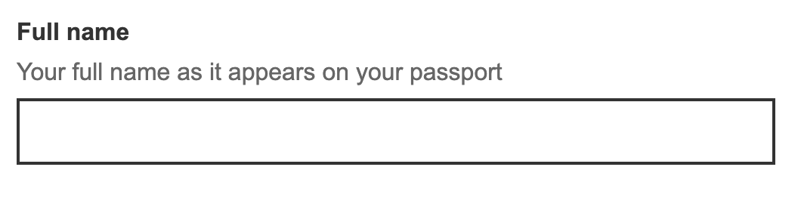
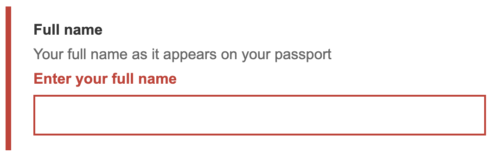

# Text input

## Overview

The text input component is a form control that lets people enter a single line of text.

It can be useful when you need to collect information, however when data is required in a specific format, it can introduce errors which need to be handled.

[View the text input component on TetraLogical.com](https://tetralogical.com/resources/accessible-components-library/text-input/)

### What problems it solves

The text input component allows people to enter free form text, instead of choosing from a list of predefined options. 

### When to use it

Use a text input when:

* It is not possible to predict users' answer
* People are expected to enter a single line of text

### When not to use it

Do not use a text input when:

* People's possible answers are limited and can be predicted (use radio buttons, checkboxes or a `<select>` instead) 
* People may need to enter multiple lines of text (use the textarea component instead)
* People are expected to enter non-text values, such as a telephone number 

### Where to use it

Text inputs are commonly used in forms to collect people's answers and personal information, such as people's name or the company they work for.  

## Accessibility requirements

### Adaptability

Helping people by honouring user preferences and by allowing adaptations to content presentation and time limits.

[View test scenarios: Adaptability](../../src/components/text-input/features/adaptability.feature)

| Standard | Description |
| --- | --- |
| [1.3.4 Orientation](https://www.w3.org/WAI/WCAG22/Understanding/orientation.html), Level AA | Content is not restricted to a single orientation, unless it's essential |
| [1.4.4 Resize Text](https://www.w3.org/WAI/WCAG22/Understanding/resize-text.html), Level AA | Text can scale up to 200% without loss of content or functionality |
| [1.4.10 Reflow](https://www.w3.org/WAI/WCAG22/Understanding/reflow.html), Level AA | Content reflows without horizontal scrolling when the viewport is 320px wide |
| [1.4.12 Text Spacing](https://www.w3.org/WAI/WCAG22/Understanding/text-spacing.html), Level AA | No loss of content occurs when line, letter or word spacing is increased |
| [1.4.8 Visual Presentation](https://www.w3.org/WAI/WCAG22/Understanding/visual-presentation.html), Level AAA | Content adjusts as expected when people apply their preferences for text colour, width, alignment, spacing, and size |
| Recommendation | Content and information remain visible and understandable when using high contrast themes |

### Animation and movement

Helping people to limit animation or reduce motion within content.

**No component-specific requirements**

### Assistive technologies and semantics

Helping people who use a screen reader or other assistive tech by using appropriate code.

[View test scenarios: Assistive technologies and semantics](../../src/components/text-input/features/assistive-technologies-and-semantics.feature)

| Standard | Description |
| --- | --- |
| [1.3.1 Info and Relationships](https://www.w3.org/WAI/WCAG22/Understanding/info-and-relationships), Level A | If the text input has hint text, the text is included in the field's [accessible name](../../src/documentation/glossary.md#accessible-name) or [accessible description](../../src/documentation/glossary.md#accessible-description) |
| [1.3.1 Info and Relationships](https://www.w3.org/WAI/WCAG22/Understanding/info-and-relationships), Level A | If the text input includes suffix or prefix, such as a currency symbol, this is included in the field's accessible name or accessible description |
| [1.3.1 Info and Relationships](https://www.w3.org/WAI/WCAG22/Understanding/info-and-relationships), Level A | If the text input has an error message, the error message is included in its accessible name or accessible description |
| [1.3.1 Info and Relationships](https://www.w3.org/WAI/WCAG22/Understanding/info-and-relationships), Level A | If the text input is visually marked as required, the required state is conveyed to screen readers |
| [1.3.1 Info and Relationships](https://www.w3.org/WAI/WCAG22/Understanding/info-and-relationships), Level A | If the text input is visually marked as disabled, the disabled state is conveyed to screen readers |
| [1.3.2 Meaningful Sequence](https://www.w3.org/WAI/WCAG22/Understanding/meaningful-sequence), Level A | The order of content in the accessibility tree matches the logical reading order |
| [1.3.5 Identify Input Purpose](https://www.w3.org/WAI/WCAG22/Understanding/identify-input-purpose), Level AA | If the text input collects personal information about the person who is filling in the form and it maps to an autocomplete field described in [Input Purposes for User Interface Components](https://www.w3.org/TR/WCAG21/#input-purposes), the text input has the `autocomplete` attribute with the appropriate value |
| [2.5.3 Label in Name](https://www.w3.org/WAI/WCAG22/Understanding/label-in-name.html), Level A | The text input's accessible name matches or includes the field's visible text label |
| [3.1.2 Language of Parts](https://www.w3.org/WAI/WCAG22/Understanding/language-of-parts), Level AA | If the text input component includes any text in a language other than the language of the page, the correct language is declared using the `lang` attribute |
| [4.1.2 Name, Role, Value](https://www.w3.org/WAI/WCAG22/Understanding/name-role-value), Level A | The text input has an accessible name |
| [4.1.2 Name, Role, Value](https://www.w3.org/WAI/WCAG22/Understanding/name-role-value), Level A | The text input has a [role](../../src/documentation/glossary.md#role) of  `textbox` |
| [4.1.2 Name, Role, Value](https://www.w3.org/WAI/WCAG22/Understanding/name-role-value), Level A | The text input's current value is conveyed to screen readers |
| Recommendation | The text input uses the native HTML `<input>` element, and its label the native HMTL `<label>` element |
| Recommendation | The text label is programmatically associated with the text input using the `label`’s `for` attribute and the `input`’s `id` attribute |
| Recommendation | If the text input has an error, the invalid state is conveyed to screen readers using the `aria-invalid` attribute |
| Recommendation | Markup can be parsed without errors |

### Colour and contrast

Helping people who struggle with colour perception or low vision.

[View test scenarios: Colour and contrast](../../src/components/text-input/features/colour-and-contrast.feature)

| Standard | Description |
| --- | --- |
| [1.4.1 Use of Color](https://www.w3.org/WAI/WCAG22/Understanding/use-of-color), Level A | Colour alone is not used to identify a text input in error |
| [1.4.3 Contrast (Minimum)](https://www.w3.org/WAI/WCAG22/Understanding/contrast-minimum), Level AA | All text content in the text input component has a contrast ratio of at least 4.5:1 against the background colours. This includes the label, value, instruction and error text, and applies to the default, focus, hover, and error states. Note: there are no contrast requirements for disabled fields |
| [1.4.11 Non-text Contrast](https://www.w3.org/WAI/WCAG22/Understanding/non-text-contrast), Level AA | The text input's borders have a contrast ratio of at least 3:1 against the background colours |
| [1.4.11 Non-text Contrast](https://www.w3.org/WAI/WCAG21/Understanding/non-text-contrast.html), Level AA | If the text input uses a custom focus indicator, this has a contrast ratio of 3:1 against the background colours |
| [1.4.6 Contrast (Enhanced)](https://www.w3.org/WAI/WCAG22/Understanding/contrast-enhanced.html), Level AAA | All text content in the text input component has a contrast ratio of at least 7:1 against the background colours, except when disabled |

### Consistency and predictability

Helping people by keeping functionality and content consistent and predictable.

[View test scenarios: Consistency and predictability](../../src/components/text-input/features/consistency-and-predictability.feature)

| Standard | Description |
| --- | --- |
| [3.2.1 On Focus](https://www.w3.org/WAI/WCAG22/Understanding/on-focus), Level A | When the text input receives keyboard focus, it does not initiate a [change of context](../../src/documentation/glossary.md#change-of-context) |
| [3.2.2 On Input](https://www.w3.org/WAI/WCAG22/Understanding/on-input), Level A | Entering a value in the text input does not result in a [change of context](../../src/documentation/glossary.md#change-of-context) |
| Recommendation | The text input's width is appropriate for the content to be entered |
| Recommendation | Disabled text inputs are avoided |
| Recommendation | The text label, hint, and error messages are positioned above and left-aligned to the text input to aid [readability](../../src/documentation/glossary.md#readability) and reduce the need to scroll horizontally |

### Images and media

Helping people to access (and remove distractions caused by) image, video and audio content.

[View test scenarios: Images and media](../../src/components/text-input/features/images-and-media.feature)

| Standard | Description |
| --- | --- |
| [1.1.1 Non-text Content](https://www.w3.org/WAI/WCAG22/Understanding/non-text-content.html), Level A | If an error message starting with an error icon is displayed, either the error message includes the word "Error" at the start or the icon has a text alternative. If the message does start with "Error", the icon is hidden from screen readers |

### Input assistance

Helping people to complete forms, enter data and pass authentication.

[View test scenarios: Input assistance](../../src/components/text-input/features/input-assistance.feature)

| Standard | Description |
| --- | --- |
| [3.3.1 Error Identification](https://www.w3.org/WAI/WCAG22/Understanding/error-identification), Level A | When there is an error, this is indicated in text and visually associated with the text input |
| [3.3.2 Labels or Instructions](https://www.w3.org/WAI/WCAG22/Understanding/labels-or-instructions), Level A | The text input's label, and hint text if provided, are persistent. The component does not rely on the use of placeholder text alone to act as the visible label or hint |
| [3.3.2 Labels or Instructions](https://www.w3.org/WAI/WCAG22/Understanding/labels-or-instructions), Level A | If there are requirements for the information the user is expected to enter, these are included in the label or as an additional hint |
| [3.3.2 Labels or Instructions](https://www.w3.org/WAI/WCAG22/Understanding/labels-or-instructions), Level A | There is a visible indication of whether the text input is required or optional |
| [3.3.3 Error Suggestion](https://www.w3.org/WAI/WCAG22/Understanding/error-suggestion.html), Level AA | Whenever possible, error messages include a suggestions for how to correct the error |

### Keyboard

Helping people who use a keyboard.

[View test scenarios: Keyboard](../../src/components/text-input/features/keyboard.feature)

| Standard | Description |
| --- | --- |
| [2.1.1 Keyboard](https://www.w3.org/WAI/WCAG22/Understanding/keyboard.html), Level A | The text input can be focused using the `Tab` key |
| [2.1.1 Keyboard](https://www.w3.org/WAI/WCAG22/Understanding/keyboard.html), Level A | A value can be entered using the keyboard |
| [2.1.2 No Keyboard Trap](https://www.w3.org/WAI/WCAG22/Understanding/no-keyboard-trap), Level A | The text input does not [trap focus](../../src/documentation/glossary.md#focus-trap) |
| [2.4.7 Focus Visible](https://www.w3.org/WAI/WCAG22/Understanding/focus-visible.html), Level AA | The text input has a visible focus indicator when it receives keyboard focus |
| [2.4.11 Focus Not Obscured (Minimum)](https://www.w3.org/WAI/WCAG22/Understanding/focus-not-obscured-minimum.html), Level AA | The text input is not fully hidden by other content when it receives keyboard focus |
| [2.1.3 Keyboard (No Exception)](https://www.w3.org/WAI/WCAG22/Understanding/keyboard-no-exception.html), Level AAA | The text input component is accessible by keyboard, with no exceptions |
| [2.4.12 Focus Not Obscured (Enhanced)](https://www.w3.org/WAI/WCAG22/Understanding/focus-not-obscured-enhanced.html), Level AAA | The text input is fully visible when it receives keyboard focus |
| [2.4.13 Focus Appearance](https://www.w3.org/WAI/WCAG22/Understanding/focus-appearance), Level AAA | If the text input uses a custom focus style, this has a solid 2 pixel thick perimeter, or equivalent, and a contrast ratio of at least 3:1 against the background colours |
| Recommendation | A custom focus style is used instead of the browser’s default, which can be hard to see against some backgrounds |

### Navigation

Helping people find the content they are looking for on a single page or across multiple pages.

[View test scenarios: Navigation](../../src/components/text-input/features/navigation.feature)

| Standard | Description |
| --- | --- |
| [2.4.6 Headings and Labels](https://www.w3.org/WAI/WCAG22/Understanding/headings-and-labels), Level AA | The text input has a clear and accurate label that informs the user about the information they are expected to enter |

### Pointer and touch

Helping people use single pointer or touch interactions.

[View test scenarios: Pointer and touch](../../src/components/text-input/features/pointer-and-touch.feature)

| Standard | Description |
| --- | --- |
| [2.5.8 Target Size (Minimum)](https://www.w3.org/WAI/WCAG22/Understanding/target-size-minimum), Level AA | The text input has a target area size, or a target area size together with spacing, of at least 24 by 24 CSS pixels |
| [2.5.5 Target Size (Enhanced)](https://www.w3.org/WAI/WCAG22/Understanding/target-size-enhanced), Level AAA | The text input has a target area size of at least 44 pixels by 44 CSS pixels |

### Text comprehension (optional)

Helping people to read and understand text content.

[View test scenarios: Text comprehension](../../src/components/text-input/features/text-comprehension.feature)

| Standard | Description |
| --- | --- |
| Recommendation | An optional text input has the text "(optional)" in its label, so people can tell it apart from the required ones |
| Recommendation | An asterisk is not used to indicate that a text input is required. Fields are required unless they are marked as optional |

## Assistive technology compatibility

This component has been tested with the following browsers and assistive technologies.

| Assistive technology | Result | Notes |
| --- | --- | --- |
| Keyboard | No issues | No notes |
| Voice Access/Chrome 154.0.8/Windows 11 | No issues | No notes |
| JAWS 2026.2603.86/Chrome 154.0.8/Windows 11 | No issues | No notes |
| NVDA 2026.1.1/Firefox 157.0/Windows 11 | No issues | No notes |
| VoiceOver/Safari macOS Tahoe 26.6 | No issues | No notes |
| VoiceOver/Safari/iOS 26.0 | No issues | No notes |
| TalkBack/Chrome 154.0.8/Android 17 | No issues | No notes |
| Windows Contrast themes | No issues | No notes |
| Windows Magnifier and/or Apple Zoom | No issues | No notes |
| Browser zoom | No issues | No notes |
| prefers-reduced-motion | Not applicable | There are no animations to reduce |

Last updated: 13 October 2026.
