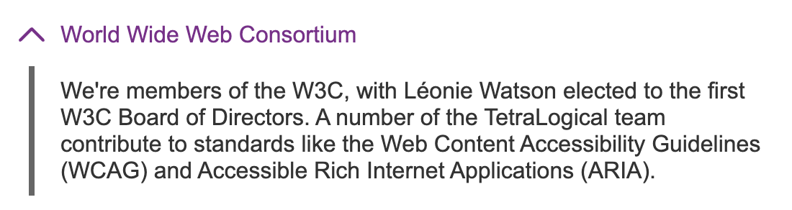

# Disclosure

## Overview

The disclosure component allows people to reveal or hide additional content.

It is made up of two parts:

- **Trigger**: Control to expand or collapse content
- **Expandable / collapsible section**: The content which is shown or hidden

To show several related disclosures one after another, use the [accordion](../accordion/README.md) component.

[View the disclosure component on TetraLogical.com](https://tetralogical.com/resources/accessible-components-library/disclosure/)

### What problems it solves

The disclosure component helps reduce clutter by hiding additional content until people decide to show it. This makes it easier for people to find and focus on important information first, and access additional content only if and when needed.

### When to use it

Use the disclosure component when you have content that people may or may not need to access.

### When not to use it

Do not use the disclosure component for important information as some people may miss it.

### Where to use it

Disclosures are generally used on busy pages to reduce overwhelm. They are also often found in settings panels, FAQs, and long forms.

### How it works

The markup is a native `
` element, labelled by a `
` element. The `open` attribute can be added to load it in an expanded state.

The component is enhanced with JavaScript, and when the script runs, it rebuilds each disclosure as a `<button>`. The reason for this, is that browsers and screen readers expose a `
` less consistently than a `<button>`, and some do not expose a heading placed inside a `
`. TalkBack on Android still does not, and older versions of Safari did not. So, to make the component behave more consistently, we use a custom disclosure component. See [TalkBack does not expose a heading inside a summary element](../../documentation/compatibility.md#talkback-does-not-expose-a-heading-inside-a-summary-element) and [Safari does not expose a heading inside a summary element](../../documentation/compatibility.md#safari-does-not-expose-a-heading-inside-a-summary-element) in the compatibility notes for more information.

When enhanced, the button describes its expanded or collapsed state using `aria-expanded`. It also points at the content it controls using `aria-controls`.

Keyboard focus stays on the button after it is activated. 

Collapsed content is hidden using `hidden="until-found"`, so anything focusable inside a collapsed section still revealed when using the browsers in-page search. Older browsers treat the attribute as plain `hidden`, so the content stays hidden until the button is used. See [Hidden versus hidden until found](../../documentation/compatibility.md#hidden-versus-hidden-until-found) in the compatibility notes for more information.

When the page is printed, every disclosure is shown expanded.

### Without JavaScript

Without JavaScript, the disclosure falls back to just rendering a native `
` element with some custom CSS styling.

## Accessibility requirements

### Adaptability

Helping people by honouring user preferences and by allowing adaptations to content presentation and time limits.

[View test scenarios: Adaptability](./features/adaptability.feature)

| Standard | Description |
| --- | --- |
| [1.3.4 Orientation](https://www.w3.org/WAI/WCAG22/Understanding/orientation.html), Level AA | Content is not restricted to a single orientation, unless it's essential |
| [1.4.4 Resize Text](https://www.w3.org/WAI/WCAG22/Understanding/resize-text.html), Level AA | Text can scale up to 200% without loss of content or functionality |
| [1.4.10 Reflow](https://www.w3.org/WAI/WCAG22/Understanding/reflow.html), Level AA | Content reflows without horizontal scrolling when the viewport is 320px wide |
| [1.4.12 Text Spacing](https://www.w3.org/WAI/WCAG22/Understanding/text-spacing.html), Level AA | No loss of content occurs when line, letter or word spacing is increased |
| [1.4.8 Visual Presentation](https://www.w3.org/WAI/WCAG22/Understanding/visual-presentation.html), Level AAA | Content adjusts as expected when people apply their preferences for text colour, width, alignment, spacing, and size |
| Recommendation | Content and information remain visible and understandable when using high contrast themes |
| Recommendation | Collapsed content is shown when the page is printed |

---

### Animation and movement

Helping people to limit animation or reduce motion within content.

**No component-specific requirements**

---

### Assistive technologies and semantics

Helping people who use a screen reader or other assistive tech by using appropriate code.

[View test scenarios: Assistive technologies and semantics](./features/assistive-technologies-and-semantics.feature)

| Standard | Description |
| --- | --- |
| [1.3.2 Meaningful Sequence](https://www.w3.org/WAI/WCAG22/Understanding/meaningful-sequence), Level A | The order of content in the accessibility tree matches the logical reading order |
| [2.5.3 Label in Name](https://www.w3.org/WAI/WCAG22/Understanding/label-in-name.html), Level A | The disclosure trigger has an [accessible name](../../documentation/glossary.md#accessible-name) that matches or includes the visible label |
| [3.1.2 Language of Parts](https://www.w3.org/WAI/WCAG22/Understanding/language-of-parts), Level AA | If any of the text in the disclosure component is in a language other than the language of the page, the correct language is declared for it using the `lang` attribute |
| [4.1.2 Name, Role, Value](https://www.w3.org/WAI/WCAG22/Understanding/name-role-value.html), Level A | The disclosure trigger has an accessible name |
| [4.1.2 Name, Role, Value](https://www.w3.org/WAI/WCAG22/Understanding/name-role-value.html), Level A | The disclosure trigger has a [role](../../documentation/glossary.md#role) of `button` |
| [4.1.2 Name, Role, Value](https://www.w3.org/WAI/WCAG22/Understanding/name-role-value.html), Level A | The `expanded` or `collapsed` state of the disclosure is conveyed to screen readers |
| Recommendation | The trigger is associated with the content it controls, using the `aria-controls` attribute |
| Recommendation | A heading placed inside the trigger keeps its heading role once the script has run |
| Recommendation | Markup can be parsed without errors |

---

### Colour and contrast

Helping people who struggle with colour perception or low vision.

[View test scenarios: Colour and contrast](./features/colour-and-contrast.feature)

| Standard | Description |
| --- | --- |
| [1.4.3 Contrast (Minimum)](https://www.w3.org/WAI/WCAG22/Understanding/contrast-minimum), Level AA | All text in the disclosure component has a contrast ratio of at least 4.5:1 against the background colours. This applies in default, hover, focus, expanded, and collapsed states |
| [1.4.11 Non-text Contrast](https://www.w3.org/WAI/WCAG22/Understanding/non-text-contrast.html), Level AA | Any icons used to indicate the disclosure state (such as a chevron or arrow) have a contrast ratio of at least 3:1 against the background |
| [1.4.11 Non-text Contrast](https://www.w3.org/WAI/WCAG22/Understanding/non-text-contrast.html), Level AA | If the disclosure trigger has a custom focus style, this must have a contrast ratio of at least 3:1 against the background |
| [1.4.6 Contrast (Enhanced)](https://www.w3.org/WAI/WCAG22/Understanding/contrast-enhanced), Level AAA | All text in the disclosure component has a contrast ratio of at least 7:1 against the background colours |

---

### Consistency and predictability

Helping people by keeping functionality and content consistent and predictable.

[View test scenarios: Consistency and predictability](./features/consistency-and-predictability.feature)

| Standard | Description |
| --- | --- |
| [3.2.1 On Focus](https://www.w3.org/WAI/WCAG22/Understanding/on-focus.html), Level A | When the disclosure trigger receives keyboard focus, it does not initiate a [change of context](../../documentation/glossary.md#change-of-context) |
| [3.2.2 On Input](https://www.w3.org/WAI/WCAG22/Understanding/on-input), Level A | Expanding or collapsing the disclosure (by selecting the disclosure trigger) does not result in an unexpected [change of context](../../documentation/glossary.md#change-of-context) |
| Recommendation | The down pointing chevron/icon is to the left of the disclosure's label |

---

### Images and media

Helping people to access (and remove distractions caused by) image, video and audio content.

[View test scenarios: Images and media](./features/images-and-media.feature)

| Standard | Description |
| --- | --- |
| [1.1.1 Non-text Content](https://www.w3.org/WAI/WCAG22/Understanding/non-text-content.html), Level A | If the disclosure trigger uses an icon without a visible text label, the icon has a text description; if a visible text label is also present, the icon is hidden from screen readers |

---

### Input assistance

Helping people to complete forms, enter data and pass authentication.

**No component-specific requirements**

---

### Keyboard

Helping people who use a keyboard.

[View test scenarios: Keyboard](./features/keyboard.feature)

| Standard | Description |
| --- | --- |
| [2.1.1 Keyboard](https://www.w3.org/WAI/WCAG22/Understanding/keyboard.html), Level A | The disclosure trigger can be focused using the <kbd>Tab</kbd> key |
| [2.1.1 Keyboard](https://www.w3.org/WAI/WCAG22/Understanding/keyboard.html), Level A | The disclosure trigger can be activated using the keyboard (typically <kbd>Enter</kbd> or <kbd>Space</kbd>) |
| [2.1.2 No Keyboard Trap](https://www.w3.org/WAI/WCAG22/Understanding/no-keyboard-trap), Level A | The disclosure component does not [trap focus](../../documentation/glossary.md#focus-trap) |
| [2.4.7 Focus Visible](https://www.w3.org/WAI/WCAG22/Understanding/focus-visible.html), Level AA | The disclosure trigger has a visible focus indicator when it receives keyboard focus |
| [2.4.11 Focus Not Obscured (Minimum)](https://www.w3.org/WAI/WCAG22/Understanding/focus-not-obscured-minimum.html), Level AA | The disclosure trigger is not fully hidden by other content when it receives keyboard focus |
| [2.1.3 Keyboard (No Exception)](https://www.w3.org/WAI/WCAG22/Understanding/keyboard-no-exception.html), Level AAA | The disclosure component is accessible by keyboard, with no exceptions |
| [2.4.12 Focus Not Obscured (Enhanced)](https://www.w3.org/WAI/WCAG22/Understanding/focus-not-obscured-enhanced.html), Level AAA | The disclosure trigger is fully visible when it receives keyboard focus |
| [2.4.13 Focus Appearance](https://www.w3.org/WAI/WCAG22/Understanding/focus-appearance), Level AAA | If the disclosure component uses a custom focus style, this has a solid 2 pixel thick perimeter, or equivalent, and a contrast ratio of at least 3:1 against the background colour |
| Recommendation | A custom focus style is used instead of the browser's default, which can be hard to see against some backgrounds |

---

### Navigation

Helping people find the content they are looking for on a single page or across multiple pages.

[View test scenarios: Navigation](./features/navigation.feature)

| Standard | Description |
| --- | --- |
| [2.4.6 Headings and Labels](https://www.w3.org/WAI/WCAG22/Understanding/headings-and-labels), Level AA | The disclosure trigger's label clearly describes the content that will be revealed |
| Recommendation | Content inside a collapsed disclosure can be found with the browser's find in page feature |
| Recommendation | A link to an anchor inside collapsed content expands the disclosure |

---

### Pointer and touch

Helping people use single pointer or touch interactions.

[View test scenarios: Pointer and touch](./features/pointer-and-touch.feature)

| Standard | Description |
| --- | --- |
| [2.5.2 Pointer Cancellation](https://www.w3.org/WAI/WCAG22/Understanding/pointer-cancellation.html), Level A | The disclosure trigger is activated on the [`up` event](../../documentation/glossary.md#updown-events), not on the [`down` event](../../documentation/glossary.md#updown-events) |
| [2.5.8 Target Size (Minimum)](https://www.w3.org/WAI/WCAG22/Understanding/target-size-minimum), Level AA | The disclosure trigger has a target area size, or a target area size together with spacing, of at least 24 by 24 CSS pixels |
| [2.5.5 Target Size (Enhanced)](https://www.w3.org/WAI/WCAG22/Understanding/target-size-enhanced.html), Level AAA | The disclosure trigger has a target area size of at least 44 by 44 CSS pixels |

---

### Text comprehension (optional)

Helping people to read and understand text content.

**No component-specific requirements**

## Assistive technology compatibility

This component has been tested with the following browsers and assistive technologies.

| Assistive technology | Result | Notes |
| --- | --- | --- |
| Keyboard | No issues | No notes |
| Voice Access/Chrome 154.0.8/Windows 11 | No issues | No notes |
| JAWS 2026.2603.86/Chrome 154.0.8/Windows 11 | No issues | No notes |
| NVDA 2026.1.1/Firefox 157.0/Windows 11 | No issues | No notes |
| VoiceOver/Safari macOS Tahoe 26.6 | No issues | No notes |
| VoiceOver/Safari/iOS 26.0 | No issues | Does not announce expanded or collapsed immediately after state change. This is a known bug with WebKit. See [aria-expanded states are not announced immediately following a change on iOS](../../documentation/compatibility.md#aria-expanded-states-are-not-announced-immediately-following-a-change-on-ios) in the compatibility notes. |
| TalkBack/Chrome 154.0.8/Android 17 | No issues | No notes |
| Windows Contrast themes | No issues | No notes |
| Windows Magnifier and/or Apple Zoom | No issues | No notes |
| Browser zoom | No issues | No notes |
| prefers-reduced-motion | Not applicable | There are no animations to reduce |

Last updated: 13 October 2026.
